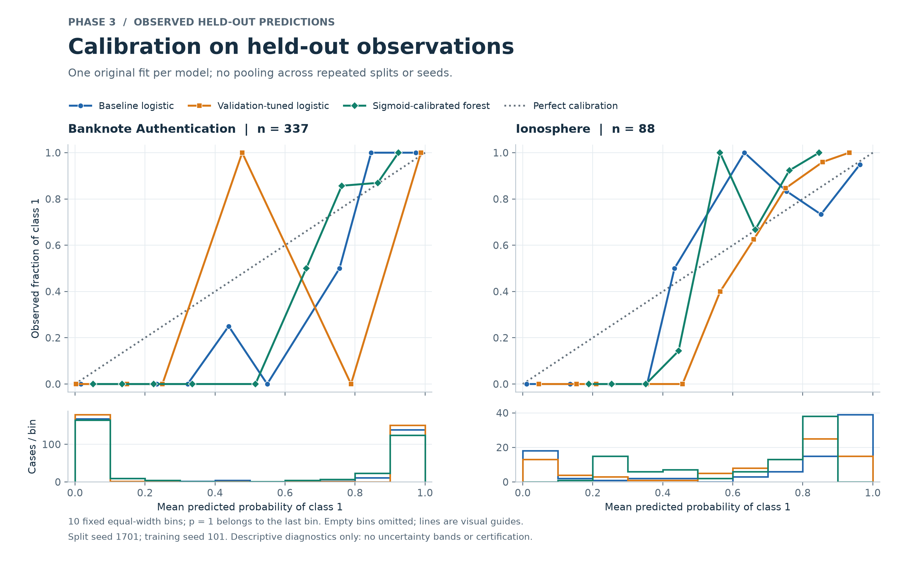

# Statistical Assurance of AI Model Changes: A Reproducible Research Framework for Probabilistic Performance, Decision Stability, and Human-Governed Model Validation

Independently developed by **Yousef Nejatbakhsh, Ph.D.** Research prototype only.
No Rutgers affiliation, NSF sponsorship, third-party certification or deployment
approval is claimed. Original project code is available under the
[MIT License](LICENSE), Copyright (c) 2026 Yousef Nejatbakhsh. Third-party
datasets and dependencies retain their own licenses; see
[licensing scope](docs/licensing.md) and [dataset notices](docs/datasets.md).

## Implemented capabilities and observed evidence

| Phase | Capability | Interpretation |
|---|---|---|
| 1 | Logistic baseline plus positive score scaling | Controlled transform, not independent training |
| 2 | Repeated development splits and training seeds | Fixed-fit losses averaged within subject; overlapping splits descriptive |
| 3 | Separate public Banknote and Ionosphere tasks; refit/test bootstrap | Method validation across domains, not transfer of the medical model |
| 4 | Strict read-only semantic verification and reviewed export | Evidence consistency, not statistical certification |

Read [archived findings](docs/validation-summary.md),
[limitations](docs/research-limitations.md), [dataset notices](docs/datasets.md)
and [reproducibility](docs/reproducibility.md).

**All classifications are exploratory and conditional on statistical assumptions.**
Confidence-interval coverage, statistical power and false-release control have
**not been established**. Case counts and loss margins are illustrative, not
power or utility guarantees. Human review is mandatory; automatic deployment
authorization is always false. No deployment system is implemented.

## Calibration on saved held-out predictions



These reliability diagrams use the archived Phase 3 **Banknote Authentication
(337 test cases)** and **Ionosphere (88 test cases)** predictions. They show the
first configured split (seed **1701**) and training seed (**101**) for each model;
repeated splits/seeds are not pooled as independent observations. Probabilities
are `expit(saved score)`. Forest sigmoid calibration was fitted on the separate
calibration partition; no model or calibrator is fitted to these plotted test data.
Class 1 is the original UCI class 1 for Banknote and good returns for Ionosphere;
see the [dataset notices](docs/datasets.md).

Ten fixed equal-width bins partition [0, 1]: [0, 0.1), ..., [0.9, 1], with
probability 1 assigned to the final bin. Each point is the bin's mean predicted
probability against its observed class-1 fraction; empty bins are omitted, lines
join populated bins only as visual guides, and the lower panels show bin counts.
The dotted diagonal represents perfect calibration. Points above it indicate
underprediction of class-1 frequency; points below it indicate overprediction.
Differences illustrate that probability agreement varies by model and dataset,
including after sigmoid calibration. Sparse bins and the small Ionosphere test
set can produce large fluctuations; these single-run curves have no uncertainty
bands and do not establish generalization, guaranteed calibration, statistical
certification or deployment approval. Human review remains mandatory.

Reproduce from the repository root in the documented short-path environment:

```powershell
& .\.venv\Scripts\python.exe -B repro/plot_calibration.py
```

The script checks input SHA256 hashes and recomputes all plotted bins against
archived metrics. [Plot data and provenance](figures/phase3_calibration.json)
record source hashes, selected seeds, bin counts and descriptive ECE values.
Only the named README figure/data derivatives are regenerated; archived
predictions and historical metrics remain unchanged.

## Windows PowerShell

From the project in VS Code's PowerShell terminal:

```powershell
& .\setup-project.ps1 -Python311 'C:\path\to\Python311\python.exe'
& .\run-all.ps1 -Python311 'C:\path\to\Python311\python.exe'
```

The interpreter path is a user-supplied example. The shared runtime restores or
verifies temporary R:, verifies the actual virtual environment version, and never
replaces an occupied drive or wrong-version environment. Use `-EnvironmentPath
.venv311` to create a separate environment. It does not modify registry, PATH,
security settings or Python 3.13. Setup installs dependencies without running an
experiment. Baseline output is a new timestamped directory; existing results are
not overwritten. Avoid directly invoking Python from the original long path:
Windows DLL loading may still fail with WinError 206.

From R: after setup:

```powershell
& .\run-phase2.ps1
& .\run-phase3.ps1 -Offline
```

Offline Phase 3 uses the release's evidence/datasets, or a previously verified
development data directory. Omit -Offline to fetch pinned official downloads.
Full Phase 3 refitting is expensive; inspect saved results without rerunning it.

## Verification and reproducibility

```powershell
& .\.venv\Scripts\python.exe -m model_assurance.release_check --root .
& .\.venv\Scripts\python.exe -m model_assurance.verify_external --output evidence/phase3 --data-dir evidence/datasets --read-only --record reports/verification-new.json
```

Verification recalculates metrics, ECE, interval metadata and values, summaries,
role RNG streams and conditional categories. It replays original model bundles
and every bootstrap validation choice, but **does not retrain every stored
forest**. It never writes into archives; detached records are exclusive-create.
Passing does not establish coverage, authenticate the publisher or enforce human
review in an external serving system. Hashes are not publisher signatures.

Selected public evidence is under evidence/ in the proposed release, with hashes
and derivative lineage. Original local results/reports/figures remain ignored.
Software versions and seeds are recorded. Windows constraints are exact; Ruff is
pinned to 0.17.5 with explicit rules, with a separate 0.7.0 compatibility check.
CI defines Linux/Windows and Python 3.10/3.11 checks; consult the exact commit
and actual workflow run before claiming hosted success. Cross-platform bitwise identity is not asserted.

## Scientific positioning and publication policy

Paired bootstrap, proper scores, calibration diagnostics and Bonferroni allocation
are established methods. Their engineering integration is not a novel theorem.
Coverage/power validation, fresh sites/cohorts, grouping, shift/subgroup risk and
related-work comparison remain proposed research, not demonstrated outcomes.

The old publisher is disabled. No script stages, commits, creates a public
repository or pushes. Public visibility requires a separate explicit author instruction after
private-repository validation; private upload was authorized in Phase 6. Dataset licenses do not license the project's code.

## Release candidate review

See the [author checklist](docs/author-review.md) and
[hosted check instructions](docs/github-actions.md). Phase 4 local verification
passed 68 tests; no hosted result or Phase 5 experiment is claimed.
